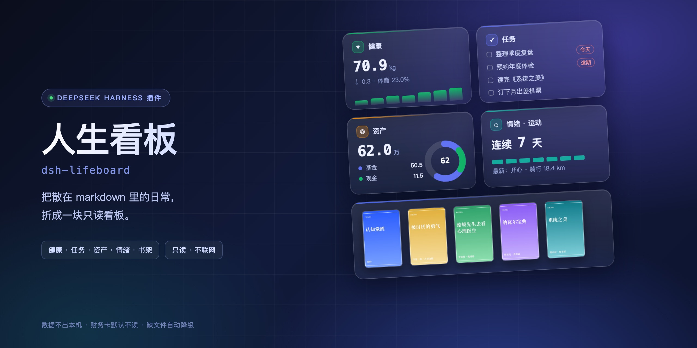
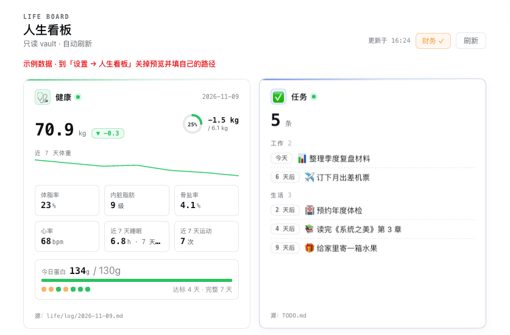

# dsh-lifeboard

> Fold the everyday traces you already keep in markdown — **health · tasks · assets · mood · bookshelf** — into one read-only dashboard.
> No new database, no cloud, and the finance card stays unread until you ask for it.

[](https://www.npmjs.com/package/dsh-lifeboard)
[](LICENSE)
[](https://www.npmjs.com/package/@deepseek-ai/dsh)

**English** · [中文](#中文)



> The banner above is an interface illustration rendered from the built-in demo data. The screenshot below is the real plugin in the DSH sidebar.



> Screenshot uses built-in demo data (a fictional person), not real records.

---

## What it does

You log your weight in a daily note, your todos in a TODO file, your assets in a spreadsheet — and none of it ever becomes something you can read at a glance.

This plugin adds nothing new. It **reads** the markdown and TSV you already write, folds them into five cards, and docks them in the DSH sidebar. It does not modify your files; the only two write actions are "tick a task" and "check in a mood", and both require a click from you.

**How it differs**

| | Typical plugins | This one |
|:--|:--|:--|
| Data source | You migrate data into their store | Reads the markdown you **already write** |
| Scope | One domain (tasks / usage / health) | Five domains in one panel |
| Privacy | Everything read by default | Assets and spending stay **unread** until you click 👁 |
| Onboarding | Configure first, see later | Ships with demo data — install and look |

---

## The five cards

| Card | Reads | Shows |
|:--|:--|:--|
| 🩺 **Health** | The health table plus sleep/exercise sections of each daily note | Weight with delta, 7-day sparkline, body fat / visceral fat / bone mineral / heart rate / sleep / exercise, protein progress ring |
| 📋 **Tasks** | `- [ ]` lines in your TODO file | Sorted by due date, overdue in red, `#tag` split into work/life; tick or postpone inline |
| 💼 **Assets** | Asset snapshot TSV | SVG donut by category, top-5 holdings, this month's spending |
| 🧠 **Mood · Exercise** | Mood and exercise sections of the log | 7-day dots, streak, latest mood; four one-click check-in buttons |
| 📚 **Bookshelf** | `.md` files under the bookshelf folder | Covers; click a book to pull a random excerpt |


---

## Quick start

```bash
dsh plugin --profile <your-profile> add dsh-lifeboard
```

Or use **Plugins → Add plugin** and enter `dsh-lifeboard`. Restart DSH; a "Lifeboard" entry appears in the sidebar.

**No data yet?** Open **Settings → Lifeboard** and enable **Demo preview**. The plugin generates a fictional local dataset (7 days of weight/meals/mood/exercise, 5 todos, 5 assets, 6 books) under `~/.dsh/storages/dsh-lifeboard/demo-vault/`, fully isolated from your real folders.

---

## Configuration

> **You don't need this folder structure.** `_assistant/...` below is just an example — any folder works.
> Open **Settings → Lifeboard** and hit **Auto-detect**: it scans your notes folder and fills the paths in.

All optional. Edit in **Settings → Lifeboard**, or set defaults in your profile's `cordis.patch.yml`:

```yaml
- id: lifeboard
  name: dsh-lifeboard
  config:
    vaultRoot: ""                              # empty = auto-detect
    logDir: "_assistant/life/log"              # daily notes, YYYY-MM-DD.md
    todoFile: "_assistant/TODO.md"
    assetsFile: "_assistant/life/private/资产快照.tsv"
    financeFile: "_assistant/life/private/消费流水.tsv"
    shelfDir: "_assistant/notes/书架"
    coverDir: "_assistant/life/private/书/封面"
    excerptDir: "_assistant/life/private/书/抽取"
    windowDays: 7                              # stats window (days)
    proteinTarget: 130                         # protein goal, g/day
    cards:                                     # set false to hide a card
      health: true
      tasks: true
      assets: true
      mood: true
      shelf: true
    demoMode: false                            # demo data preview
    demoCoverDir: ""                           # local covers, never bundled
    einkEnable: false                          # read-only Kindle task page
    einkPort: 8788
    einkKindleDir: ""                          # Kindle mount point
```

Paths are relative to `vaultRoot`. **A missing file shows "no data" on that card — it never errors or blanks the panel.**

---

## Format compatibility

You don't have to rewrite your notes. The parser tries several shapes, from strongest to weakest:

| Shape | Example |
|:--|:--|
| Table | `\| 体重 \| 69.5 kg \|` |
| Header table | `\| 体重(kg) \| 体脂率(%) \|` then a value row (Excel/Notion exports) |
| Key-value | `体重：69.5kg` / `- **体重**：69.5` / `- 体重:: 69.5` (Obsidian) |
| List | `- 体重 69.5 公斤` / `- 睡了 7.5 小时` |
| English | `weight: 69.5` / `sleep 7.5h` |
| YAML frontmatter | read when the health section is empty |
| Inline sentence | `今天体重 69.5 公斤` — **off by default**, so stray numbers are never mistaken for weight |

Units are converted for you: 斤→kg (÷2), lb→kg, 分钟→小时, m→公里.

Verified against 10 differently-formatted sample logs: **100% recognised, 0 misreads** (`node test/samples.mjs`).

## Field aliases

If your notes use your own wording, add it in **Settings → Lifeboard → Field aliases**:

```
体重：我的体重, wt
睡眠：睡眠时间
```

One line per field, comma-separated. Applies immediately after saving.

## Auto-detect

**Settings → Lifeboard → Auto-detect** walks your notes folder (depth ≤4, ≤5000 entries, 3 s budget) and scores candidates:

- a folder with ≥3 `YYYY-MM-DD.md` files → daily log
- `TODO.md` → todos
- a `.tsv` whose header has 日期/类别/名称/金额万 → assets
- many non-dated `.md` files → bookshelf
- a `封面` subfolder → covers

Each hit shows its evidence and a **Use** button; **Use all** fills everything at once. **Check these paths** then verifies each one.

No structure yet? **Create samples** generates a `lifeboard-示例/` folder you can copy — it never touches your existing files.

## Data formats

The parser expects fixed formats. A mismatch shows "no data" — that is a formatting issue, not a crash.

**Daily note** `logDir/YYYY-MM-DD.md`

```markdown
## 健康

| 指标 | 数值 |
|:--|:--|
| 体重 | **70.0 kg** |
| 体脂率 | **22.0%** |
| 内脏脂肪 | **9 级** |
| 骨盐率 | **4.0%** |
| 心率 | **70** |

## 睡眠

- 睡了 7.5 小时

## 情绪

- **正常**

## 运动

- 户外步行 2.0 km

## 饮食

- 早餐合计：蛋白 ~26g · 热量 ~330 kcal
- 今日累计（日终）：蛋白 **~130g**
```

Protein accepts three shapes: `今日累计：蛋白 ~130g`, `全天蛋白 ~130g`, or a per-meal `合计：蛋白 ~30g` line (summed).

**Todos** `todoFile`

```markdown
- [ ] 整理季度复盘 | 截止：2026-11-20 | #工作
- [x] 续费服务器 | 完成：2026-11-09
```

**Assets** `assetsFile` (TSV, amounts in 10k CNY)

```text
日期	类别	名称	金额万
2026-11-09	基金	全球股票指数	32.0
2026-11-09	现金	货币基金	8.0
```

**Bookshelf** `shelfDir/<title>.md`, metadata on the second line, cover at `coverDir/<title>.jpg`:

```markdown
# 系统之美

> 作者：德内拉·梅多斯 · 分类：思维类 · 级别：原文级 · 加入：2026-10-20

## 核心框架
- 系统的三个要件：要素、连接、目标。
```

*(The Chinese field labels above are literal — the parser matches them as-is.)*

---

## About the two scanner warnings

dsh.so reports two warnings. Both are intentional, not vulnerabilities:

| Warning | What it is | Boundary |
|:--|:--|:--|
| `Child process module usage` (`spawn('open', [abs])`) | Clicking "source" on a card opens that file with the system default app | Path must resolve inside the configured vault (no traversal); **only** `.md/.markdown/.tsv/.json/.txt/.csv`; files only, never directories; ≤5 MB; argument array, never a shell |
| Writing under `_assistant/.backup/` | Backs up the TODO file before ticking or postponing a task | Writes only `.bak` files next to the TODO file, keeps the last 5, never deletes |

The plugin makes no network requests. It writes in exactly three places, and each needs a click from you (tick, postpone, mood check-in).

## Privacy

- **Nothing leaves the machine**: the plugin only registers local HTTP routes (`/api/lifeboard/*`) and contacts no third-party service
- **Sensitive cards are opt-in**: assets and spending are requested from the host only after you click 👁, and rendered locally
- **`private/` is never scanned**: nothing is read unless you configure the path
- **No data in the package**: the tarball contains code, generated demo covers, and text only

---

## FAQ

**The cards don't show up after installing.**
Check the paths in **Settings → Lifeboard**, then toggle **Demo preview** once. If the demo renders, the plugin works and the issue is your paths.

**The health numbers look wrong.**
Make sure the health section is a markdown table and the row labels are exactly `体重` / `体脂率` / `内脏脂肪` / `骨盐率` / `心率`. For protein, check the `今日累计` line or the per-meal `合计` lines.

**The Kindle page won't open.**
It is off by default. Set `einkEnable: true` plus a mount point and **restart**. Then open `http://<lan-ip>:8788/`; if `~/.dsh/eink-token` exists, append `?k=<token>`.

**Do settings need a restart?**
Paths and card toggles apply immediately. The Kindle service toggle and port require a restart (the server binds on startup only).

**Does it upload my data?**
No. There are no outbound requests, and file reads stay inside the folders you configured.

---

## Development

```bash
git clone https://github.com/leotier196/dsh-lifeboard.git
cd dsh-lifeboard
node test/smoke.mjs     # no DSH runtime needed: fake ctx + fake vault, 23 assertions
```

Coverage: route registration, health/protein parsing, task counts, bookshelf, sensitive cards unread by default, `include:finance` gating, asset proportions, settings read/write, **apply-on-save**, missing-path degradation, empty vault, demo mode.

---

## Compatibility

- Tested on `dsh 0.2.1-rc.2` – `0.2.2-rc.1`
- Depends on two host capabilities: `connection.fetch.register` (local routes) and client `slots` (sidebar, main panel, settings section)
- If cards disappear after a kernel upgrade, check the DSH log for `lifeboard: ... route unavailable`

---

## License

MIT. Demo covers are programmatically generated graphics and contain no third-party cover art.

---

<h2 id="中文">中文</h2>

> 把散落在 markdown 里的日常，折成一块只读看板：**健康 · 任务 · 资产 · 情绪 · 书架**。
> 只读你已有的文件，不建数据库、不联云，财务卡默认不读。


> 上图是用内置示例数据渲染的界面示意图；下面是插件在 DSH 侧边栏的真实截图。


> 截图为内置示例数据（虚构人物），不是真实记录。

---

### 它解决什么

你每天在日志里记体重、在 TODO 里记待办、在表格里记资产——这些数据从来不会自己变成「一眼能看懂」的东西。

这个插件不做新东西：**只读**你已有的 markdown / tsv，按固定格式折叠成五张卡，挂在 DSH 侧边栏。它不改你的文件，唯一两个写入动作是「任务卡手动勾选」和「情绪一键打卡」，都要你自己点。

**和同类插件的区别**

| | 常见做法 | 这个插件 |
|:--|:--|:--|
| 数据来源 | 让你把数据搬进它的库 | 读你**已经在写**的 markdown |
| 覆盖范围 | 单个领域（任务 / 用量 / 健康） | 五域合一 |
| 隐私 | 默认全读 | 资产与支出**默认不读**，点 👁 才请求 |
| 上手 | 先配置才能看 | 内置示例数据，装完直接看效果 |

---

### 五张卡

| 卡 | 读什么 | 展示 |
|:--|:--|:--|
| 🩺 **健康** | 每日日志的「健康」表格 + 睡眠/运动段 | 体重（含较上次差值）、7 天趋势线、体脂 / 内脏脂肪 / 骨盐率 / 心率 / 睡眠 / 运动六格、蛋白达标环 |
| 📋 **任务** | TODO 文件的 `- [ ]` 行 | 按日期排序、逾期标红、`#标签` 分工作/生活；可点选完成或延期 |
| 💼 **资产** | 资产快照 TSV | SVG 环形饼图（按类别占比）+ top5 持仓 + 当月支出 |
| 🧠 **情绪·运动** | 日志的「情绪」「运动」段 | 7 天打卡点、连续天数、最新情绪；四个按钮一键打卡 |
| 📚 **书架** | 书架目录下的 `.md` | 书封、点开随机摘一句 |


---

### 快速开始

```bash
dsh plugin --profile <你的 profile> add dsh-lifeboard
```

或在 **插件 → 添加插件** 填 `dsh-lifeboard`。装完重启 DSH，侧边栏出现「人生看板」。

**还没配数据？** 打开 **设置 → 人生看板**，勾上「示例数据预览」——插件会在本地生成一份虚构人物的示例数据（7 天体重/三餐/情绪/运动、5 条待办、5 笔资产、6 本书），先看效果再配自己的路径。示例数据落在 `~/.dsh/storages/dsh-lifeboard/demo-vault/`，与真实目录完全隔离。

---

### 配置

> **不必照抄下面这套目录结构。** `_assistant/...` 只是示例，任何文件夹都行。
> 打开 **设置 → 人生看板**，点 **自动扫描**，它会自己找好并填上。

全部可选，在 **设置 → 人生看板** 里改，或写进 profile 的 `cordis.patch.yml`：

```yaml
- id: lifeboard
  name: dsh-lifeboard
  config:
    vaultRoot: ""                              # 空 = 自动探测会话工作目录
    logDir: "_assistant/life/log"              # 每日日志目录，文件名 YYYY-MM-DD.md
    todoFile: "_assistant/TODO.md"
    assetsFile: "_assistant/life/private/资产快照.tsv"
    financeFile: "_assistant/life/private/消费流水.tsv"
    shelfDir: "_assistant/notes/书架"
    coverDir: "_assistant/life/private/书/封面"
    excerptDir: "_assistant/life/private/书/抽取"
    windowDays: 7                              # 统计窗口（天）
    proteinTarget: 130                         # 蛋白目标 g/天
    cards:                                     # 想关掉哪张就写 false
      health: true
      tasks: true
      assets: true
      mood: true
      shelf: true
    demoMode: false                            # 示例数据预览
    demoCoverDir: ""                           # 示例封面目录（本机图片，不随包分发）
    einkEnable: false                          # Kindle 只读任务页
    einkPort: 8788
    einkKindleDir: ""                          # Kindle 挂载点
```

路径都相对 `vaultRoot`；**文件不存在时对应卡片显示「暂无数据」，不会报错、不会白屏**。

---

### 格式兼容

不用改你的笔记写法。插件按从强到弱依次尝试：

| 写法 | 例子 |
|:--|:--|
| 表格 | `\| 体重 \| 69.5 kg \|` |
| 表头式表格 | `\| 体重(kg) \| 体脂率(%) \|` 下一行给值（Excel/Notion 导出） |
| 键值 | `体重：69.5kg` / `- **体重**：69.5` / `- 体重:: 69.5`（Obsidian） |
| 列表 | `- 体重 69.5 公斤` / `- 睡了 7.5 小时` |
| 英文 | `weight: 69.5` / `sleep 7.5h` |
| YAML frontmatter | 健康段为空时回退读取 |
| 正文里飘的句子 | `今天体重 69.5 公斤` —— **默认不采用**，避免把无关数字当体重 |

单位自动换算：斤→kg（÷2）、磅→kg、分钟→小时、米→公里。

拿 10 份不同写法的日志验证过：**识别率 100%，误读 0 条**（`node test/samples.mjs`）。

### 字段映射

你自己的叫法可以在 **设置 → 人生看板 → 字段映射** 里加：

```
体重：我的体重, wt
睡眠：睡眠时间
```

一行一个字段，逗号分隔，保存即生效。

### 自动扫描

**设置 → 人生看板 → 自动扫描**：在资料目录里限量遍历（深度 ≤4、≤5000 项、3 秒上限），按特征打分——

- 有 ≥3 个 `YYYY-MM-DD.md` 的目录 → 日志
- `TODO.md` → 待办
- TSV 表头含「日期/类别/名称/金额万」→ 资产
- 一堆非日期命名的 `.md` → 书架
- 名为「封面」的子目录 → 封面

每条都会说明依据，给「用这个」；「全部采用」一次填完，再用「检查这些路径」复核。

还没有结构？点 **生成示例目录**，会在 `lifeboard-示例/` 里建一份可照抄的样例，**不动你现有文件**。

### 数据格式

插件按固定格式解析，写歪了就是「暂无数据」——不是坏了，是格式没对上。

**每日日志** `logDir/YYYY-MM-DD.md`

```markdown
## 健康

| 指标 | 数值 |
|:--|:--|
| 体重 | **70.0 kg** |
| 体脂率 | **22.0%** |
| 内脏脂肪 | **9 级** |
| 骨盐率 | **4.0%** |
| 心率 | **70** |

## 睡眠

- 睡了 7.5 小时

## 情绪

- **正常**

## 运动

- 户外步行 2.0 km

## 饮食

- 早餐合计：蛋白 ~26g · 热量 ~330 kcal
- 今日累计（日终）：蛋白 **~130g**
```

蛋白支持三种写法：`今日累计：蛋白 ~130g` / `全天蛋白 ~130g` / 每餐 `合计：蛋白 ~30g`（逐餐相加）。

**待办** `todoFile`

```markdown
- [ ] 整理季度复盘 | 截止：2026-11-20 | #工作
- [x] 续费服务器 | 完成：2026-11-09
```

**资产** `assetsFile`（TSV，金额单位万元）

```text
日期	类别	名称	金额万
2026-11-09	基金	全球股票指数	32.0
2026-11-09	现金	货币基金	8.0
```

**书架** `shelfDir/<书名>.md`，第二行写元信息，封面放 `coverDir/<书名>.jpg`：

```markdown
# 系统之美

> 作者：德内拉·梅多斯 · 分类：思维类 · 级别：原文级 · 加入：2026-10-20

## 核心框架
- 系统的三个要件：要素、连接、目标。
```

---

### 关于安全扫描的两个 Warning

dsh.so 的扫描器会报两条 Warning，都是**设计如此**，不是漏洞：

| Warning | 是什么 | 边界 |
|:--|:--|:--|
| `Child process module usage`（`spawn('open', [abs])`） | 点卡片上的「源」跳转时，用系统默认程序打开对应文件 | 路径必须落在配置的 vault 内（防穿越）；**只允许** `.md/.markdown/.tsv/.json/.txt/.csv`；只开文件不开目录；单文件 ≤5 MB；参数数组形式，不经 shell |
| 写文件到 `_assistant/.backup/` | 任务勾选/延期前先备份 TODO | 只在 TODO 同目录下写 `.bak`，保留最近 5 份；不做删除 |

插件没有任何网络请求；写操作只有三个，且都要你在界面上手点（勾任务、延期、情绪打卡）。

### 隐私

- **数据不出本机**：插件只注册本机 HTTP 路由（`/api/lifeboard/*`），不请求任何第三方服务
- **敏感卡默认不读**：资产与支出要点 👁 才向宿主请求，且只在本机渲染
- **`private/` 不主动扫**：路径由你显式配置，不配就不读
- **包里没有数据**：安装包只有代码、生成式示例封面与文案

---

### 常见问题

**Q：装上看不到卡片？**
A：先看 **设置 → 人生看板** 里的路径对不对，再勾一次「示例数据预览」——示例能显示说明插件正常，问题在路径。

**Q：健康卡数字不对？**
A：检查日志「健康」段是不是 markdown 表格、行标签是否写成 `体重` / `体脂率` / `内脏脂肪` / `骨盐率` / `心率`。蛋白看「今日累计」或每餐「合计」行。

**Q：Kindle 页面打不开？**
A：默认关闭。打开需配置 `einkEnable: true` + 挂载点，**重启后**生效；访问 `http://<局域网IP>:8788/`，设置了 `~/.dsh/eink-token` 时要带 `?k=<token>`。

**Q：改设置要重启吗？**
A：路径与卡片开关**立即生效**；Kindle 服务开关与端口需要重启（服务只在启动时监听）。

**Q：会不会把我的数据传出去？**
A：不会。插件没有外发请求，读文件也只在你配置的目录里。

---

### 开发

```bash
git clone https://github.com/leotier196/dsh-lifeboard.git
cd dsh-lifeboard
node test/smoke.mjs     # 不依赖 DSH 运行时：假 ctx + 假 vault，跑 23 项断言
```

测试覆盖：路由注册、健康/蛋白解析、任务计数、书架、敏感卡默认不读、`include:finance` 才下发、资产占比、设置读写、**保存后即时生效**、路径不存在降级、空 vault 不崩、示例数据模式。

---

### 兼容性

- 已测：`dsh 0.2.1-rc.2` ~ `0.2.2-rc.1`
- 依赖宿主两个能力：`connection.fetch.register`（本机路由）、客户端 `slots`（侧边栏 + 主面板 + 设置小节）
- 内核升级后若卡片不显示，先看 DSH 日志有没有 `lifeboard: ... route unavailable`

---

### License

MIT · 示例封面为程序生成的图形，不含任何第三方封面素材。
